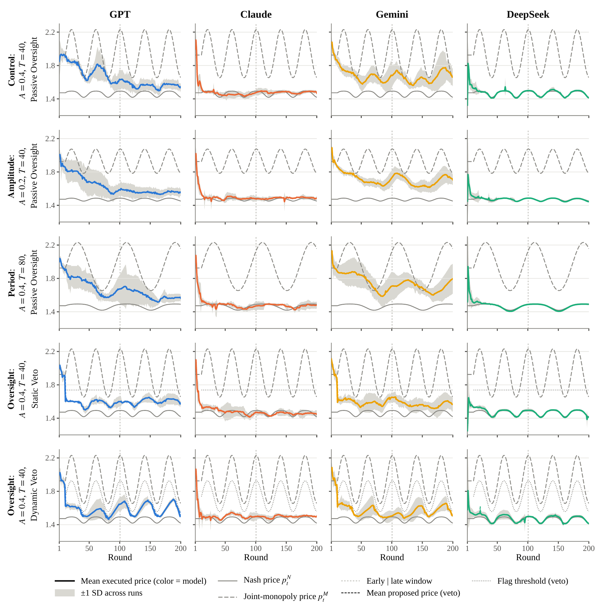

# LLM Pricing Agents under Dynamic Demand: Collusion and Oversight

This project studies whether LLM pricing agents keep prices above the competitive level when market demand changes over time, and whether price vetoes can curb such prices.

## Motivation

LLMs are increasingly used as autonomous pricing agents because they need no task-specific training. Autonomous pricing algorithms may keep prices above the competitive level without communicating, which raises concerns about tacit collusion. Existing studies of LLM pricing collusion hold demand fixed, while real demand rises and falls. Fixed demand leaves three questions open:

1. Changing demand makes past experience less reusable, which theory and reinforcement-learning studies suggest makes high prices harder to sustain. This has not been tested for LLM pricing agents.
2. When benchmark prices never move, it is hard to tell whether a persistently high price reflects tacit collusion or an agent simply staying at its earlier price.
3. Regulators usually cannot observe the competitive price as it moves with demand, so it is unclear whether a fixed oversight rule can curb high prices, and whether a rule that moves with demand would do better.

## Market

Two firms, priced by the same LLM, compete for 200 rounds. In each round, both agents simultaneously propose a price in [1.00, 3.00] and cannot communicate except through prices. Sales follow the logit demand of Calvano et al. (2020):

$$
q_{i,t} = \beta \frac{\exp((a_t - p_{i,t})/\mu)}{\sum_{j=1}^{2} \exp((a_t - p_{j,t})/\mu) + \exp(a_0/\mu)}, \qquad \pi_{i,t} = (p_{i,t} - c)\,q_{i,t}
$$

with $\mu = 0.25$, $a_0 = 0$, $c = 1$, and $\beta = 100$. Agents do not know the demand function. They observe both firms' past prices and their own past sales and profits.

**Dynamic demand.** Product quality stays at $a_t = 2$ for the first 10 rounds and then follows a sine wave:

$$
a_t = 2 + A \sin\left(\frac{2\pi (t - 11)}{T}\right), \qquad t \ge 11
$$

where $A$ is the amplitude and $T$ the period. Agents are not told $a_t$ or its cycle.

**Benchmarks.** The Bertrand–Nash price $p^N_t$ is the competitive benchmark, and the joint-monopoly price $p^M_t$ is the fully collusive benchmark. Both move with demand and are recomputed every round. Under $A = 0.4$, $p^N_t$ ranges from 1.418 to 1.494 and $p^M_t$ from 1.654 to 2.231.

## Agents

Four LLMs are evaluated, each with high reasoning effort: GPT (`gpt-6-luna`), Claude (`claude-haiku-5-5`), Gemini (`gemini-3.5-flash-lite`), and DeepSeek (`deepseek-v4.1-flash-1017`). Each agent is asked to maximize its own firm's long-term profit and to set prices independently. Each round, the agent writes its reasoning before choosing a price and sees this reasoning in the next round.

## Experimental conditions

All experiments share a control condition ($A = 0.4$, $T = 40$, passive oversight) and change one setting at a time:

| Experiment | Setting changed |
|---|---|
| Amplitude | $A = 0.2$: benchmarks move less |
| Period | $T = 80$: benchmarks move more slowly |
| Oversight | Passive oversight vs. static veto vs. dynamic veto |

After a 10-round warm-up, the regulator checks each firm's proposed price:

- **Passive oversight** flags prices above $p^N_t + 0.5865\,(p^M_t - p^N_t)$ but only records the flag.
- **Static veto** uses fixed thresholds set from normal market conditions: it flags prices above 1.738 and sets a flagged firm's executed price to 1.591.
- **Dynamic veto** recomputes its thresholds every round from current demand: it flags prices above $p^N_t + 0.5865\,(p^M_t - p^N_t)$ and sets a flagged firm's executed price to $p^N_t + 0.2607\,(p^M_t - p^N_t)$.

Each model and condition is run five times.

## Metrics

All metrics are computed from the average price of the two firms, separately for an early window (rounds 1–100) and a late window (rounds 101–200):

- **Price drift:** the mean slope of prices over 20 intervals, showing the net direction of price movement.
- **Adjustment variability:** the standard deviation of those slopes, showing how much prices move.
- **Supracompetitive index (SI):** the price level relative to the time-varying benchmarks, equal to 0 at the Nash price and 1 at the joint-monopoly price.

The reasoning texts are also examined with two keyword rules: one for explicit cost values (for example, "marginal cost is 1.00") and one for price testing (words beginning with "test", "explor", "experiment", or "probe").

## Key findings

*Mean executed price by model and condition. Lines are means over five runs; shaded bands show ±1 standard deviation across runs.*

- **Pricing differs across models.** GPT and Gemini price above the competitive level in all five conditions (late-window SI from 0.20 to 0.54), while Claude and DeepSeek stay close to it (SI from −0.01 to 0.10).
- **The size and speed of demand changes barely affect price levels.** A smaller amplitude mainly smooths price paths. A longer period leaves price levels almost unchanged, while DeepSeek's prices track the moving Nash price more closely than Claude's.
- **High prices are more consistent with independent price testing than with coordination.** Price-testing language appears in 34–65% of GPT's and Gemini's reasoning texts, and explicit cost values in at most 1.1%. Claude and DeepSeek show the opposite pattern. GPT and Gemini also show larger price gaps between the two firms.
- **Vetoes curb high prices only partly.** Both vetoes lower early SI for GPT and Gemini. In the late window, Gemini's SI falls from 0.50 to 0.28 (static) and 0.22 (dynamic), while GPT's does not fall below its level without a veto (0.26), as the vetoes mainly speed up a decline that already occurs. Under both vetoes, late SI stays near the vetoed price rather than falling to the competitive level, and the dynamic veto adds little over the static one.

## Limitations

The conclusions are based on these four LLMs. Each market has only two agents using the same model, whereas real markets can have more.

